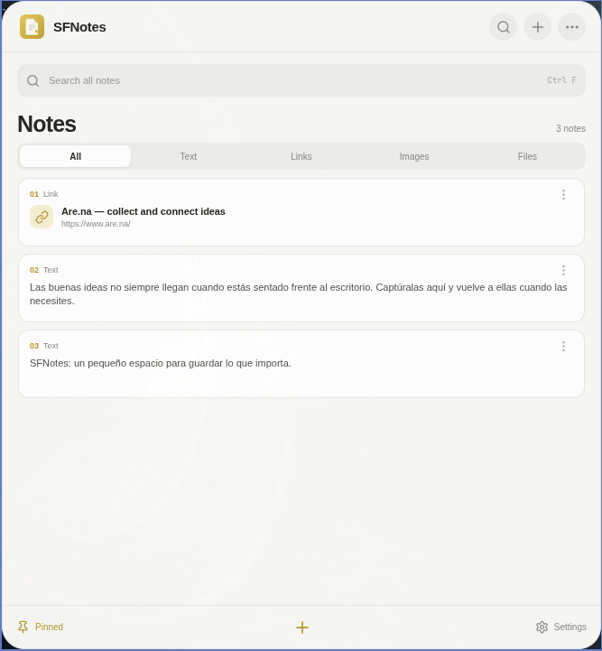

# SFNotes

**Un petit espace flottant pour garder l’essentiel à portée de main.** Enregistrez du texte, des liens, des images et des fichiers sur votre bureau, puis retrouvez-les et copiez-les quand vous en avez besoin. Vos notes sont automatiquement enregistrées sur votre appareil.

[English](README.md) · [Español](README.es.md) · [Français](README.fr.md) · [Deutsch](README.de.md) · [Italiano](README.it.md) · [Português](README.pt.md)

## Captures d’écran

Cette capture montre SFNotes en application de bureau. Ouvrez **Réglages** en bas à droite pour changer la langue, l’apparence et les raccourcis.



## Télécharger et installer

Téléchargez la dernière version pour votre système depuis [GitHub Releases](https://github.com/Salpeper/sfnotes/releases).

### Windows 10/11

1. Ouvrez la dernière version et téléchargez le fichier se terminant par `Setup.exe` ou `.exe`.
2. Lancez l’installateur et suivez les étapes. Vous pouvez choisir le dossier d’installation.
3. Ouvrez **SFNotes** depuis le menu Démarrer.

Cette version n’est pas signée. Si SmartScreen s’affiche, vérifiez que le fichier vient de ce dépôt, puis choisissez **Plus d’informations → Exécuter quand même**.

### macOS (Intel et Apple Silicon)

1. Téléchargez le fichier `.dmg` de la dernière version.
2. Ouvrez-le et faites glisser **SFNotes** vers **Applications**.
3. Éjectez l’image disque et ouvrez SFNotes depuis Applications.

SFNotes n’est pas encore signée ni notarisée. Si macOS la bloque, ouvrez **Réglages Système → Confidentialité et sécurité**, descendez jusqu’à Sécurité et choisissez **Ouvrir quand même** pour SFNotes. Cette option apparaît après la première tentative d’ouverture.

### Linux (x64)

Les formats AppImage, DEB et RPM se trouvent dans les **Assets** de la dernière version. AppImage convient à la plupart des distributions.

**AppImage :**

```bash
chmod +x SFNotes-*.AppImage
./SFNotes-*.AppImage
```

**Debian, Ubuntu et dérivées :** `sudo apt install ./SFNotes-*.deb`  
**Fedora :** `sudo dnf install ./SFNotes-*.rpm`  
**openSUSE :** `sudo zypper install ./SFNotes-*.rpm`

Si AppImage signale l’absence de FUSE, installez un paquet compatible FUSE 2 ou utilisez le paquet DEB/RPM de votre distribution. Le comportement des fenêtres flottantes et des espaces de travail dépend de l’environnement de bureau et du gestionnaire de fenêtres.

## Utiliser SFNotes

1. **Enregistrer un élément :** copiez du texte, un lien ou une image, puis appuyez sur `Ctrl+V` (Windows/Linux) ou `⌘V` (macOS), ou cliquez sur **+**. Le menu **…** permet d’ajouter des fichiers.
2. **Le retrouver :** recherchez dans le champ prévu à cet effet ou filtrez avec **Toutes**, **Texte**, **Liens**, **Images** ou **Fichiers**.
3. **Le copier :** cliquez sur une note pour la copier dans le presse-papiers. Maintenez `Shift` en cliquant pour la copier et la supprimer de SFNotes.
4. **Gérer une note :** faites un clic droit (ou utilisez le menu **⋮**) pour copier, couper ou supprimer. Ce menu permet aussi de modifier les notes textuelles et les liens.
5. **Personnaliser l’application :** ouvrez **Réglages** en bas à droite pour changer le thème, la couleur de surbrillance, la taille du texte, l’espacement des notes, la langue et les raccourcis. Vous pouvez aussi garder la fenêtre au premier plan et numéroter les notes.

Dans les réglages, vous pouvez définir des raccourcis globaux pour enregistrer le presse-papiers et capturer l’écran, même lorsque SFNotes est en arrière-plan. macOS peut demander l’autorisation d’enregistrement de l’écran lors de la première capture.

## Fonctionnalités

- Aperçu du texte, des liens, des images et des fichiers ; numérotation facultative.
- Recherche et filtres par type de note.
- Thèmes clair, sombre et lavande ; trois couleurs de surbrillance ; taille du texte et espacement réglables.
- Interface en anglais, espagnol, français, allemand, italien et portugais.
- Fenêtre toujours au premier plan en option et enregistrement local automatique.
- Recherche des mises à jour depuis **Réglages → Mises à jour** dans les versions installées.

## Vos données

SFNotes conserve les notes et les préférences sur cet appareil. Le contenu est enregistré dans `snippets.json`, dans le dossier de données Electron de votre utilisateur. Les notes ne sont ni envoyées sur GitHub ni synchronisées entre appareils ; ce dépôt contient le code source de l’application.

## Compiler depuis les sources

Vous avez besoin de [Node.js](https://nodejs.org/) et npm. Clonez ce dépôt puis exécutez :

```bash
npm ci
npm run desktop:dev
```

Pour créer un paquet pour le système actuel :

```bash
npm run dist:linux    # Linux : AppImage, DEB et RPM
npm run dist:windows  # Windows : installateur NSIS
npm run dist:mac      # macOS : DMG et ZIP universels
```

Les paquets sont créés dans `release/`. Compilez les versions macOS sur macOS et Windows sur Windows. GitHub Actions utilise un runner natif par système et publie les paquets lors de l’envoi d’une étiquette `vX.Y.Z`.

## Compatibilité

- Windows permet de garder SFNotes au-dessus des autres fenêtres ; Electron ne permet pas de l’afficher automatiquement sur tous les bureaux virtuels.
- macOS prend en charge le premier plan et l’affichage sur tous les espaces. Les mises à jour automatiques nécessitent une signature Apple, absente des versions actuelles.
- Sous Linux, le placement et les espaces de travail dépendent de l’environnement. Les compositeurs Wayland peuvent limiter la position et la taille.
- Les installateurs actuels ciblent x64 sur Windows/Linux et une version universelle (Intel + Apple Silicon) sur macOS.
- Couper une image la copie dans le presse-papiers et la retire de SFNotes sans modifier le fichier source.

## Technologies

[Electron](https://www.electronjs.org/) · [React](https://react.dev/) · [Vite](https://vite.dev/) · [electron-builder](https://www.electron.build/) · [Lucide](https://lucide.dev/)
